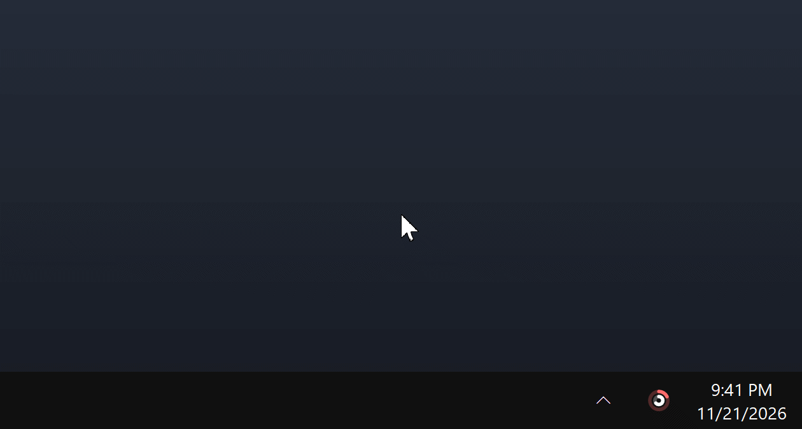

# Gearfuel

[](https://github.com/mpfluger/gearfuel/actions/workflows/ci.yml)
[](https://github.com/mpfluger/gearfuel/releases/latest)

Battery levels of your wireless mice, keyboards, controllers and headsets in one Windows tray icon, with how long each will last.



## Install

Download **Gearfuel-win-Setup.exe** from the [latest release](https://github.com/mpfluger/gearfuel/releases/latest) and run it. It installs for your user only (no admin rights needed), sets Gearfuel to start with Windows, and installs the .NET runtime if it's missing. Gearfuel then keeps itself up to date.

The installer isn't code-signed yet, so Windows SmartScreen may warn about it: choose *More info → Run anyway*.

Windows hides new tray icons in the overflow menu; drag Gearfuel's onto the taskbar to keep it in sight. To uninstall, use *Settings → Apps*.

## Supported devices

| Devices | Connection |
| --- | --- |
| Bluetooth devices that Windows itself shows a battery level for in *Settings → Bluetooth & devices* (mostly Bluetooth LE mice, keyboards and headsets) | Bluetooth |
| Razer wireless mice and keyboards | Razer USB receiver, or cable |
| Logitech devices with HID++ 2.0 battery reporting (most current mice and keyboards) | LIGHTSPEED, Bolt or Unifying receiver, or cable |
| Sony DualShock 4, DualSense, DualSense Edge | USB or Bluetooth |
| Xbox controllers (level in four steps) | Xbox Wireless Adapter, or Bluetooth |
| HyperX Cloud II Wireless, SteelSeries Arctis Nova 7 and Arctis 7 / Pro, Corsair Void headsets | USB dongle |

Tested with a Razer DeathAdder V3 HyperSpeed and a Logitech PRO X TKL on their receivers, and a DualShock 4 over Bluetooth. The rest follow documented protocols but haven't been tried yet. If your device doesn't show up or reads wrong, [open an issue](https://github.com/mpfluger/gearfuel/issues/new?template=device-support.yml) with the report from *Copy diagnostics* in the icon's menu.

## Usage

- The icon has up to two rings: outside, the device that needs charging soonest; inside, the next one. A full ring is a full battery; with no devices found, both rings are empty.
- **Red**: won't last a day at its usual pace (20% or less, until Gearfuel has learned the pace). **Green**: charging. **Gray**: no answer for 15 minutes, with its last level; it goes away after an hour. Mice and keyboards that are just asleep keep their color.
- Hover the icon for every device, with its time left. After about an hour of use, that's hours of use left (*~40h use*), or for a device that has barely drained yet, how long it lasts at least (*100h+ use*); after a day, days left at your usual pace, which keeps adapting to the last few days of use. Charging doesn't reset what Gearfuel has learned, and while charging it shows the time until full.
- When a device won't last the day, Gearfuel reminds you to charge it once you pause, e.g. when a controller is switched off, and says when a charging one is full. Windows' Focus Assist can hold them back while you play.
- Readings refresh every minute, right away when a device is plugged in, removed or connects, after waking or unlocking, and when you hover the icon.
- Click the icon for *Ring color*, *Charge reminders*, *Start with Windows*, *Copy diagnostics* (what Gearfuel sees, for an issue) and *Exit*. Rings are white or black like other tray icons, or your Windows accent color, blue, purple, pink or yellow. An accent that could be mistaken for red, green or gray falls back to white or black.
- Screen readers announce every device's level on the icon. With the keyboard, press Win+B, move to the icon with the arrow keys, and press Enter for the menu.

Everything runs locally. The only network access is a daily check for updates on GitHub.

## Build from source

Requires Windows 10 or later and the [.NET 10 SDK](https://dotnet.microsoft.com/download).

```powershell
dotnet test
dotnet run --project src/Gearfuel
```

Pushing a `v*` tag builds the installer and publishes a release.

## How it works

Windows only knows the battery level of some Bluetooth devices. For everything else, Gearfuel talks to each device family in its own protocol over raw HID. Each family is an `IBatterySource` in [`src/Gearfuel/Devices`](src/Gearfuel/Devices):

- **Bluetooth**: the battery level Windows stores on the device's Bluetooth device node.
- **Razer**: request/response feature reports, as documented by [OpenRazer](https://github.com/openrazer/openrazer).
- **Logitech**: HID++ 2.0 requests, directly or through the receiver, as documented by [Solaar](https://github.com/pwr-Solaar/Solaar).
- **PlayStation**: the battery byte in the controller's regular input reports, as laid out in the Linux `hid-playstation` driver.
- **Xbox**: Windows' XInput battery information.
- **Headsets**: vendor-specific requests, as documented by [HeadsetControl](https://github.com/Sapd/HeadsetControl).

The tests check each protocol against byte sequences captured from real devices, or against a simulated Logitech receiver.

## Known limitations

- Razer Synapse and Logitech G HUB talk to the same devices. Gearfuel tells its replies apart from theirs, but under heavy traffic a reading can be skipped until the next refresh.
- Logitech devices that only report a battery voltage (some older G mice) aren't supported.
- Controllers that another app opens exclusively (e.g. DS4Windows with *Hide DS4 Controller* on) can't be read.
- Windows doesn't tell whether a Bluetooth device is charging, so those never show as charging.

## License

[MIT](LICENSE)
